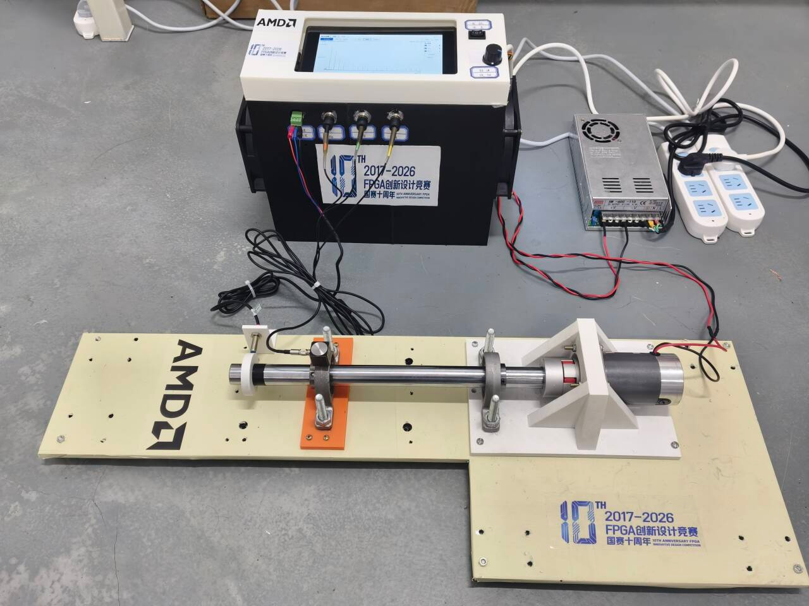

# Zynq 三轴振动采集与现场故障诊断

2026 AMD FPGA 自主选题赛道，初级组。平台为 **AX7Z020 / XC7Z020**，使用 Vivado 2025.2、ARM Linux 与 Qt。系统实现三路振动及测速采集、SD分段保存、波形/频谱/加速度显示、四状态标注、板端训练与检测。



项目原创部分采用 [MIT](license.txt)；Linux、Qt配套和Digilent等组件保留各自许可，见[许可范围](license_status.md)与[第三方说明](third_party_notices.md)。公开资料中的机械照片由项目方提供；测试输入与合成信号均单独标明来源。

## 按官方提交栏目阅读

```text
zynq-vibration-workbench/
├── README.md
├── src/       # RTL、PS应用、驱动与平台源
├── sim/       # 仿真入口、真实XSim图与验证结果
├── build/     # 构建脚本、综合/实现及性能报告
├── board/     # 上板运行入口、实测与参考对照
├── data/      # 明确标注的测试输入与参考结果
├── skill/     # 可迁移工程Skill、模板、工具与复用试验
└── report/    # 正式设计报告、大模型协作记录与图片
```

`docs/`补充复现、许可、命名和路径映射，`licenses/`保存第三方文本。七个目录均包含实际材料，不以空目录代替验收证据。

| 官方栏目 | 本仓库入口与内容 |
|---|---|
| 完整工程源码 | [src/](src/README.md)：PS应用、当前有效RTL、驱动、平台及配置；本项目未采用HLS |
| 仿真与正确性 | [sim/](sim/README.md)：仿真启动、黄金参考、逐码检查与27张真实XSim截图，标明历史版本和FFT stub边界 |
| 构建、综合与实现 | [build/](build/README.md)：host/ARM/PL入口、资源/时序/CDC/DRC报告与性能对照 |
| 上板与参考对比 | [board/](board/README.md)：合成数值实板验收、历史运行观察与明确目标的数值运行脚本 |
| 测试数据 | [data/](data/README.md)：测试夹具、生成器和对应参考，不作为机械分类实测数据 |
| 可复用Skill | [skill/](skill/README.md)：适用范围、用法、失效条件、提炼来源与真实验证范围 |
| 设计报告与协作 | [report/](report/README.md)：七项报告内容、真实协作摘录、纠错过程与复现说明 |

## 作品重点与评分证据

| 评测项 | 权重 | 本项目重点与证据 |
|---|---:|---|
| 创新性与应用价值 | 30 | 现场采集、人工标签、板端训练与检测闭环；[设计报告](report/design_report.pdf)、[框图](report/figures/system_architecture.png) |
| 性能与资源优化效果 | 20 | 对称FIR预加、三轴并行、共享FFT、双口BRAM及MMIO批处理；[PL方法和案例](skill/examples/project_case/README.md)、[实现/性能报告](build/reports/README.md) |
| 功能正确性与设计完整性 | 20 | 原码/预览分流、定点/索引/握手验证、实板合成数值对照；[仿真](sim/README.md)、[板端验证](board/README.md) |
| 大模型协作与技能包 | 15 | 真实提示、回答及纠错摘录；跨声学/遥测复用与检查工具；[协作记录](report/llm_interactions.md)、[Skill](skill/README.md) |
| 文档质量与可复现性 | 15 | 目录、接口、依赖、实际入口、证据身份与复现边界；[构建步骤](docs/build.md)、[报告](report/README.md)、[源码清单](source_manifest.json) |

评分结论由赛事评审确定。上表提供材料入口，不把历史仿真、合成输入或训练回放写成独立机械识别精度。

## 已实现的软硬件分工

- **PL采集**：ADC时序、测速同步、记录组帧与采集DMA；原码独立保存。
- **PL分析**：PS经AXI-Lite送入完整原码窗，三轴对称FIR抽取至5kHz、统计与削顶计数、Hann、共享8192点FFT、功率/频带及结果冻结。当前分析接口为PS送料，HP2/rawtap不属于已实现功能。
- **PS**：采集/存储管理、69维特征与42维随机森林、现场训练和四分类推理、Qt显示与触摸。RPM用于记录/显示，不用作生产模型的匹配门槛。

完整平台历史Routed占用：LUT14722、FF20024、BRAM36等效71.5、DSP19；分析100MHz，WNS+0.603ns、WHS+0.045ns。继承的CDC/约束警告在报告中保留。FIR局部周期、MMIO调用与完整特征API分别计时，不能合并成整机加速。

## 从主机复验开始

在Linux/WSL准备CMake、C++17、Qt5 Core/Gui/Widgets开发组件、pkg-config、Python3.10+/NumPy，以及xvfb-run、Xvfb和xauth。主机入口以xcb平台和1920×1080的Xvfb屏幕运行原生坐标交互测试。先使用新建、包外的ASCII构建目录：

```bash
git clone https://github.com/wjc2222/zynq-vibration-workbench.git
cd zynq-vibration-workbench
python3 -B build/scripts/verify_source_manifest.py
bash build/scripts/build-host.sh /tmp/zynq_host_new
```

随后按[构建说明](docs/build.md)执行ARM交叉构建、PL与仿真；按[板端说明](board/README.md)准备匹配目标。构建入口不会自动刷写开发板。Linux历史全系统集成、外部SDK/厂商IP取得与新目标板验收条件单独列明，不以主机测试替代。

Skill可单独复制使用，离线检查不需要本项目硬件；基础27项与通用工具62项合成检查，以及独立陌生队伍试用，见[Skill验证](skill/README.md)。通用PYNQ加分需要额外跨板/overlay运行证据，本项目不以离线案例代替。

## 文件命名与版本

路径使用英文且无空格/中文。新建材料使用小写；官方示例的`README.md`、智能体入口`SKILL.md`、CMake/内核/Buildroot固有文件名及原IP绑定名保留兼容性，逐项记录在[命名例外](docs/filename_case_exceptions.json)。这是一份明确的兼容性清单，不把例外说成已获官方豁免。改目录的来源与哈希见[路径映射](docs/path_mapping.json)。

本仓库是开源工程与参赛材料整理，不表示已上传赛事平台或取得接收回执。未发布真实机械BIN、训练模型、个人日志、工具安装或未经对应材料核定的固件二进制。模型精度、冷启动和具体目标板验证均按各自证据范围报告。
