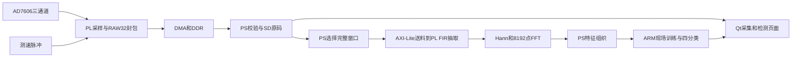

# 系统架构与职责

分析为PS送料的回放协处理器，不是从ADC直接分叉到全自动硬件分类。当前PL返回滤后序列、统计和频谱数据；随机森林训练与推理运行在ARM。原始数据保存、显示预览和诊断窗口分别管理，显示丢帧不能被当作SD原始记录丢失。

每条RAW32记录32字节，文件头4096字节。原始采样50 kHz时记录有效载荷为1.6 MB/s。连续模式按CAPSTRM1会话分段发布，保留index/tick/CRC/会话身份；窗口提取遇到真实缺口必须重新积累连续历史。预览抽稀不用于替代训练输入。

三轴物理方向由实际接线和安装记录决定，不由CH编号推断。加速度显示按各通道灵敏度与已有增益/零偏换算，不能把参数填写视为实测标定。转速用于展示和原记录追溯，不作为生产RF42的输入或参考选择条件。
