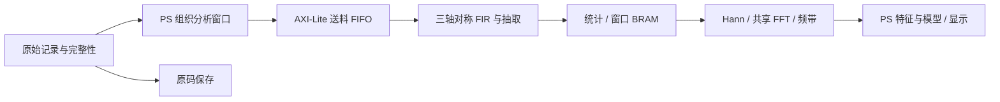

# 工程案例：如何利用PL资源

这是AX7Z020振动工作台的具体实现，用来说明可迁移方法，不给新工程预设三通道、固定采样档或随机森林。数据取自既有实现/试验记录，本次Skill升级没有重新采集机械数据或重新上板跑性能。

## 把运算映射到合适资源

分析支路由PS经AXI-Lite向PL送料；PL完成FIR、抽取、统计、Hann与FFT/频带计算，PS负责特征组织、模型训练推理、存储与GUI。原始采集保存通路单独保留。当前实例不是ADC直接rawtap分析，也没有实现HP2 DMA。

| 资源 | 在实例中的具体作用 | 可迁移的工程方法 |
|---|---|---|
| DSP | 定点乘加、加窗、FFT及平方路径 | 先定符号/位宽/吞吐，再看实际映射；一个宽乘法可能占多个DSP，不能把三条乘法通道写成整机仅3个DSP |
| LUT | AXI握手、FIFO信用、地址与状态机、比较/饱和、调度 | 把重复运算交给规则数据通路；检查高扇出、多路选择与意外LUTRAM，不追求填满LUT |
| FF | 流水线、中间状态、握手与结果冻结 | 保存与数据对齐的valid/索引/状态，检查额外流水是否改变协议；FF也支持频率与时序取舍 |
| BRAM | 双口FIR历史、系数、窗口/FFT缓存与结果 | 明确每周期读写端口、深度/宽度/打包和延迟；不能仅按总bit容量推断可实现 |

## 对称FIR：减少工作而不是堆乘法器

奇数长度对称系数满足 `h[k] = h[L-1-k]`。镜像样本先预加，中心样本只用一次，乘加项从L变为 `(L+1)/2`。实例中三轴并行，signed16样本预加扩为signed17，与signed24系数得到signed41乘积，进入signed56累加，完整累加后统一舍入与signed24饱和。

FIR历史使用双口BRAM读取前向与镜像地址，避免不恰当的多地址描述导致LUTRAM膨胀。这是对称预加的时分复用抽取器，不能写成已经实现多相地址分解。更改系数不再对称时，必须回退通用实现或重新设计。

| 原采样率 | 抽头L | 抽取D | 乘加项/轴/输出 | 输出采样率 |
|---|---:|---:|---:|---:|
| 50 kHz | 641 | 10 | 321 | 5 kHz |
| 25 kHz | 321 | 5 | 161 | 5 kHz |
| 10 kHz | 129 | 2 | 65 | 5 kHz |
| 5 kHz | 65 | 1 | 33 | 5 kHz |

共享8192点Hann/FFT核节约为每轴复制大核的成本。5kHz下窗长1.6384秒，bin间隔约0.61035Hz；实际分辨能力还受窗函数和观测条件影响。每窗所需原始帧为 `L + (8192-1)×D`，50kHz档为82551帧；不能只取8192个高采样率点再补零伪造低频历史。

## 用同一结果验收速度

| 指标 | 优化前→后 | 证据范围 |
|---|---|---|
| 50kHz FIR状态周期 | 5,267,456→2,654,208，减少49.61% | FIR隔离RTL仿真，FFT为明确stub；不是整机延迟 |
| 同PL MMIO分析调用中位数 | 124.239595→76.995511 ms，减少38.03% | 实板合成输入，每采样档/后端3次；同bit/算法，不代表机械精度或并发UI |

FIR回归有28个对称案例、688128次逐样点比较和504项统计比较。驱动改进按FIFO信用批量送料，保留INDEX/READY握手；signed24结果在确认语义后仅取LO32，真正64位统计/频谱/频带仍完整读。七组payload除本就变化的周期字段外保持一致。

结论是：算术减少与搬运减少分别验证。核周期、驱动API、特征API、采集到显示延迟分别计时，不能将49.61%或38.03%冒充整机加速。

## 实现报告与边界

Vivado2025.2、XC7Z020-2、分析时钟100MHz，完整平台Routed结果：

| 项目 | 占用/容量 | 使用率 |
|---|---:|---:|
| LUT | 14722/53200 | 27.67% |
| FF | 20024/106400 | 18.82% |
| BRAM36等效 | 71.5/140 | 51.07% |
| DSP | 19/220 | 8.64% |

WNS +0.603ns，WHS +0.045ns，DRC Error为0。保留的两个pixel-to-AXI Unsafe/Critical CDC端点及ADC约束警告仍需按平台评估；不能据正裕量宣称所有CDC/约束问题已消除。与受保护V6平台比较，LUT减少551、FF减少20、BRAM增加3、DSP不变，说明收益伴随资源取舍。

公开[资源报告](evidence/utilization.rpt)、[时序报告](evidence/timing_summary.rpt)只替换Host/Command两行身份/路径信息，其余行及所有数值表保持原字节。原件与公开副本SHA见[来源记录](evidence/report_provenance.json)，不把公开副本当作原件哈希；[案例数据](evidence/engineering_case.json)是已说明字段筛选的摘要。

## 迁移到其他项目

声学任务可替换采样率、通道、FIR系数、FFT长度；低速遥测可仅保留统计/阈值或不使用FFT。先用吞吐与资源预算决定是否共享核，再以独立黄金参考确认数值，重做BRAM端口、时钟与接口验收。以上百分比与周期只属于本实例，不作为新任务预期收益。
